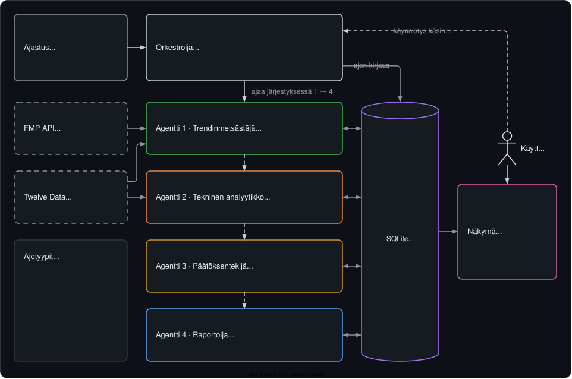

# sijoitusAnalysaattori

Sääntöpohjainen osakeanalyysijärjestelmä, joka etsii, pisteyttää ja seuraa osakkeita
automaattisesti. Neljä agenttia hakee dataa kahdesta rajapinnasta, analysoi ehdokkaat
teknisesti ja hoitaa **fiktiivistä 10 000 dollarin salkkua**. Jokainen osto ja myynti
tallentuu perusteluineen.

Salkun tuottoa verrataan SPY:hyn eli S&P 500 -indeksiä seuraavaan ETF:ään.
Nousumarkkinassa lähes mikä tahansa salkku näyttää voittoa, joten vain ero
vertailuindeksiin kertoo, toimiiko malli.

**Keskeiset ratkaisut**

- **Selkeä arkkitehtuuri.** Agentit eivät kutsu toisiaan, vaan jakavat tiedon yhden
  SQLite-kannan kautta. Jokaisen vaiheen voi tarkastaa ja testata erikseen.
- **Luotettava data.** Järjestelmä kieltäytyy ajamasta kesken olevalla pörssipäivällä,
  ja jokainen ohitettu osake kirjataan syineen.
- **Jäljitettävyys.** Jokainen ajo tallentaa mallin version, vakiot ja git-commitin,
  joten jälkikäteen näkee, millä säännöillä mikäkin päätös tehtiin.
- **Testattavuus.** Yli 400 testiä. Pisteytys ja päätökset ovat puhtaita funktioita,
  joita voi testata ilman verkkoa ja tietokantaa.
- **Automaatio.** Ajot käynnistyvät Windowsin Tehtävien ajoituksella, ajolukko estää
  päällekkäiset ajot, ja Streamlit-näkymä näyttää salkun tuoton suhteessa SPY:hyn.
- **Vastuullinen datankäsittely.** API-avaimet peitetään lokeista ja tietokannasta, eikä
  FMP:n raakadataa julkaista palvelun käyttöehtojen vuoksi.

`Python` · `SQLite` · `pandas` · `Streamlit` · `Altair` · `pytest` · `Ruff` · `PowerShell`

Projekti on toteutettu agenttiavusteisesti Claude Code -koodausagentilla. Vastasin
arkkitehtuurista, vaiheiden määrittelystä ja laadunvarmistuksesta; agentti kirjoitti
koodin. Työtapa on kuvattu kohdassa [Kehityksestä](#kehityksestä).

> Oikeaa rahaa ei liiku missään vaiheessa. Projekti mittaa, toimiiko pisteytysmalli;
> se ei käy kauppaa eikä ole sijoitusneuvontaa.

## Miten se toimii



Neljä agenttia ajetaan kiinteässä järjestyksessä. **Agentit eivät kutsu toisiaan** —
jokainen lukee edellisen tuloksen tietokannasta ja kirjoittaa omansa sinne. SQLite on
ainoa jaettu tila, mikä tekee jokaisesta vaiheesta erikseen tarkasteltavan ja
testattavan.

| Agentti | Tehtävä |
|---|---|
| **1 · trendinmetsästäjä** | Hakee ehdokkaita Financial Modeling Prepistä: sisäpiirikaupat, analyytikkoarviot, hintatavoitteet ja kongressin jäsenten kaupat. Pisteyttää ja karsii. |
| **2 · tekninen analyytikko** | Hakee kurssihistorian Twelve Datasta, laskee tunnusluvut (ATR, RSI, liukuvat keskiarvot, EMA20 ja EMA100) ja antaa risk/reward-pisteet 0–10 yhden desimaalin tarkkuudella. Asettaa stop-lossin edellisen pohjan alle. |
| **3 · päätöksentekijä** | Tekee osto-, pito- ja myyntipäätökset. Ostaa riittävät pisteet saaneita osakkeita salkun rajoissa ja myy, kun stop-loss laukeaa tai nousutrendi päättyy (EMA20 laskee EMA100:n alle). Jokainen päätös tallennetaan perusteluineen. |
| **4 · raportoija** | Laskee salkun tilannekuvan ja tuoton sekä kokonaisuutena että pelkkien positioiden osalta, ja vertaa sitä SPY:hyn. |

Ajotyyppejä on kaksi: **normaaliajo** etsii uusia ehdokkaita ja voi avata positioita,
**tarkistusajo** käy avoimet positiot läpi ja päättää pidetäänkö vai myydäänkö.

Jokainen ajo kirjaa `runs`-tauluun käytetyt vakiot, mallin version ja git-commitin.
Kuukausien päästä voi siis selvittää millä säännöillä mikäkin päätös tehtiin.

## Asennus

Vaatii Python 3.10 tai uudemman.

```bash
python -m venv .venv
.venv\Scripts\activate          # Windows
pip install -r requirements.txt
```

API-avaimet `.env`-tiedostoon repon juureen (ks. `.env.example`):

```
FMP_API_KEY=oma_avaimesi
TWELVE_DATA_API_KEY=oma_avaimesi
```

Molemmista palveluista saa ilmaisen avaimen. Twelve Datan ilmaistaso sallii 800 kutsua
vuorokaudessa, mihin järjestelmä on mitoitettu.

## Käyttö

Selainkäyttöliittymä, josta ajot käynnistetään ja tulokset näkyvät:

```bash
scripts\nakyma.cmd              # tai: .\scripts\nakyma.ps1
```

Avautuu osoitteeseen `localhost:8501`. Palvelin elää vain niin kauan kuin ikkuna on
auki — koneelle ei jää mitään taustalle pyörimään.

Pelkkä ajo ilman käyttöliittymää:

```bash
scripts\aja.cmd                             # tarkistusajo
.\scripts\aja.ps1 -Ajotyyppi normaali       # uusien ehdokkaiden haku
.\scripts\aja.ps1 -Ajotyyppi molemmat       # tarkistus ensin, sitten normaali
```

### Ajastus

```bash
scripts\ajastus_asenna.cmd      # asentaa ajastetun ajon Windowsin Tehtävien ajoitukseen
scripts\ajastus_poista.cmd      # poistaa sen; ajot tehdään taas vain käsin
```

Ajastettu ajo tekee tarkistuksen ti–la ja normaaliajon ti ja pe klo 10 Suomen aikaa,
aina tarkistuksen ensin. Jos kone on silloin kiinni, ajo tehdään kun kone avataan, mutta
vain jos New Yorkin pörssi ei ole vielä auennut. Väliin jäänyt ajo ei siirry seuraavalle
päivälle. Kone ei koskaan herää ajoa varten, ajo tehdään vain kirjautuneena, ja ikkuna
näkyy aina. Ajo käynnistyy myös 2 minuuttia kirjautumisen jälkeen, jos se on vielä
tekemättä; jos ajettavaa ei ole, ikkuna näyttää syyn ja sulkeutuu itse. Ajastettu ajo ei aja committaamatonta `agents/`- tai `core/`-koodia.
Tarkemmin: `scripts/README.md`.

### Milloin ajo onnistuu

**Arkisin klo 07:00–16:30 Suomen aikaa, viikonloppuna lauantaiaamusta klo 7 alkaen.**
Kesäaikasiirtymien välisinä viikkoina (maaliskuussa sekä loka–marraskuun vaihteessa)
ikkuna on tuntia aiemmin.

Analyysi perustuu päättyneisiin pörssipäiviin. Kesken olevan päivän kynttilän huippu,
pohja ja päätöskurssi muuttuvat vielä, mikä vääristäisi esimerkiksi 52 viikon huipun.
Järjestelmä kieltäytyy ajamasta sen ulkopuolella eikä kirjaa kieltäytymisestä mitään —
ei tietokantariviä eikä API-kutsuja.

Huomaa että ikkuna sulkeutuu pörssin **avautuessa**, ei sulkeutuessa: klo 16:30 Suomen
aikaa on 09:30 New Yorkissa. Illalla klo 23 data on yhä kesken, koska New Yorkissa on
sama päivä keskiyöhön asti.

## Rakenne

```
agents/       neljä agenttia, yksi tiedosto kukin
core/         orkestroija, tietokanta, asetukset, pörssiaika, lokitus, ajastus, ajolukko
dashboard/    Streamlit-käyttöliittymä, tuottograafi ja tapahtumaloki (lukee kantaa, ei kirjoita siihen)
scripts/      käynnistimet (.ps1 ja .cmd)
tests/        yksikkötestit
tools/        api_koetin.py — rajapintojen käsin kokeiluun
data/         tietokanta ja ajojen arkisto (versionhallinnassa vain ajojen _ajo.json)
```

Päätöslogiikka on erotettu puhtaiksi funktioiksi tiedon hausta, joten pisteytys ja
päätökset ovat testattavissa ilman verkkoa ja tietokantaa.

## Testit

```bash
pytest                      # yli 400 testiä
ruff check .
ruff format --check .
```

Jokainen kehitysvaihe päättyi siihen että testit ja Ruff menivät läpi ennen commitia.

## Keskeiset säännöt

Kaikki mallin vakiot ovat yhdessä tiedostossa (`core/asetukset.py`) ja tallentuvat
jokaiseen ajoon:

| | |
|---|---|
| Aloituspääoma | 10 000 USD |
| Positiokoko | 1 000 USD (10 % salkusta) |
| Positioita enintään | 10 |
| Ostoja per ajo enintään | 2 |
| Ostoraja | risk/reward-pisteet ≥ 7 |
| Stop-loss | edellisen pohjan alle (ensin viikko-, sitten päiväkaavio), enintään 20 % ostohinnasta |
| Myynti | stop-loss tai nousutrendin päättyminen (EMA20 laskee EMA100:n alle) |
| Takaisinosto samaan symboliin | 30 päivän jäähy, ellei nousutrendi ala myynnin jälkeen uudelleen |
| Vertailuindeksi | SPY |

## Tunnetut rajoitukset

- **Stop toteutuu vasta seuraavan aamun tarkistuksessa.** Ajot tulevat ajastettuna
  ti–la klo 10, kun kone on käytössä. Stop tarkistetaan edellisen päivän
  päätöskurssia vastaan, ja päivinä jolloin konetta ei avata, tarkistusta ei tehdä
  lainkaan — kone ei herää itsestään. Epäsäännölliset välit näkyvät `runs`-taulun
  aikaleimoista.
- **Toteutunutta historiaa on vähän.** Suljettuja kauppoja ei vielä ole tarpeeksi,
  jotta mallin toimivuudesta voisi sanoa mitään.
- **Kaupankäyntikuluja ja liukumaa ei mallinneta.** Ostot ja myynnit tapahtuvat
  päätöskurssiin.
- **Pyhäpäiviä ei tunneta kalenterista.** Kellonaikaan perustuva ennakkotarkistus
  päästää pyhäpäivän läpi, jolloin varsinainen datatarkistus keskeyttää ajon.
- **FMP:n raakadata ei ole repossa.** Financial Modeling Prepin käyttöehdot kieltävät
  datan julkaisemisen, joten ajojen syötteet tallentuvat vain paikalliseen
  `data/arkisto/`-kansioon. Reposta löytyvät vain ajojen omat `_ajo.json`-tiedostot.

## Kehityksestä

Projekti on toteutettu agenttiavusteisella ohjelmistokehityksellä. Koodin kirjoitti
Claude Code -koodausagentti, ja käytin Claudea myös suunnittelun ja tarkistusten tukena.
Minun vastuullani olivat järjestelmän arkkitehtuuri, mallin säännöt, vaiheiden
määrittely ja jokaisen muutoksen hyväksyminen.

Tekoäly oli kehitystyökalu, ei osa järjestelmää: analysaattorin neljä agenttia ovat
sääntöpohjaisia ohjelmamoduuleja, joiden jokainen päätös on jäljitettävissä.

Työ eteni vaihe kerrallaan, ja git-historiassa on yli 30 vaihekohtaista committia:

1. **Määrittely:** vaiheen tavoite, muutettavat tiedostot ja testitapaukset etukäteen.
2. **Toteutus** koodausagentilla.
3. **Laadunvarmistus:** testit ja Ruff läpi, ajo oikeaa rajapintaa vasten ja tulosten
   vertailu odotettuun ennen committia.

Vakavimmat virheet löytyivät oikeasta datasta, eivät testeistä:

- kesken olevan pörssipäivän vääristämä data
- käteisen osuuden vääristämä tuottoluku
- jäljettömiin katoavat ehdokkaat.

Jokainen johti omaan korjausvaiheeseensa.
